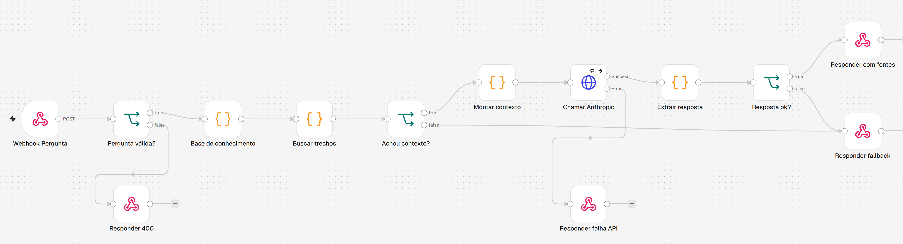

# agente-rag

Fluxo de demonstração com dados fictícios. A base de conhecimento fala de uma empresa inventada, a Acme Cursos. Nos testes deste repositório a API da Anthropic é simulada por um mock local: a chamada real nunca foi feita.

## Problema

Um atendimento precisa responder perguntas usando só o que está na base de conhecimento da empresa, mostrando de onde veio a resposta. Quando a base não cobre o assunto, o certo é dizer que não sabe e passar para o suporte, sem gastar chamada de API nem inventar resposta.

## Como funciona



1. **Webhook Pergunta** recebe `{ "pergunta": "..." }`.
2. **Pergunta válida?** recusa vazio ou texto acima de 1000 caracteres com 400.
3. **Base de conhecimento** guarda 6 documentos fictícios dentro do próprio fluxo, para ele funcionar sem banco.
4. **Buscar trechos** faz busca por palavra-chave. Remove acento e palavras comuns, dá 2 pontos para termo no título e 1 para termo no texto, corta abaixo de 2 pontos e pega até 3 trechos.
5. **Achou contexto?** vai direto para **Responder fallback** quando nada passou do corte. Nesse caso a API não é chamada.
6. **Montar contexto** coloca os trechos e a pergunta em tags XML e monta o system prompt. O prompt manda responder só com os trechos, citar os ids e escrever `SEM_RESPOSTA` quando eles não bastarem.
7. **Chamar Anthropic** faz `POST /v1/messages` por um nó HTTP Request. O modelo padrão é `claude-sonnet-5-5`, trocável por `ANTHROPIC_MODEL`.
8. **Extrair resposta** olha `stop_reason` antes de ler `content`, porque recusa chega como HTTP 200. Também trata resposta cortada e `SEM_RESPOSTA`.
9. **Responder com fontes** devolve a resposta e os trechos citados. Qualquer resposta aproveitável que não veio cai em **Responder fallback**.

Exemplo de resposta:

```json
{
  "resposta": "Resposta simulada pelo mock com base em [KB-01].",
  "fontes": [{ "id": "KB-01", "titulo": "Política de reembolso" }],
  "usouFallback": false,
  "modelo": "claude-sonnet-5-5"
}
```

### Tratamento de erro

A chamada tenta 2 vezes, com 1 segundo entre as tentativas e timeout de 60 segundos. Se falhar, o fluxo responde 502 com `etapa: anthropic`. O corpo também manda `fallbacks: "default"` com o header beta `server-side-fallback-2026-07-01`, para a própria API tentar outro modelo quando houver recusa.

### Credencial

A chave vem de `$env.ANTHROPIC_API_KEY` e não aparece no JSON. Se preferir credencial do n8n, troque o header `x-api-key` do nó por uma credencial do tipo Header Auth. Num ambiente real, a credencial é a melhor opção, porque header montado por expressão pode aparecer nos dados de execução salvos.

## Como importar

1. No n8n, abra **Workflows**, depois **Import from File**, e escolha `workflow.json`.
2. Defina `ANTHROPIC_API_KEY` no ambiente do n8n, junto de `N8N_BLOCK_ENV_ACCESS_IN_NODE=false`, que libera `$env` nas expressões.
3. Troque os documentos em **Base de conhecimento** pelos seus.
4. Ative o fluxo. O endereço fica em `/webhook/agente-rag`.

## Como testar

Siga o [README da raiz](../README.md#como-rodar). Para mandar uma pergunta na mão, com o n8n e o mock no ar:

```bash
curl -X POST http://127.0.0.1:5678/webhook/agente-rag \
  -H "content-type: application/json" \
  -d '{"pergunta":"Qual o prazo para pedir reembolso?"}'
```

## Limitações

- A busca é por palavra-chave, sem embeddings. Sinônimo não é encontrado: "devolução do dinheiro" não acha "reembolso". Para uma base maior, o nó **Buscar trechos** seria trocado por um vector store.
- O webhook não tem autenticação. Antes de expor na internet, precisa de token e limite de requisições, porque cada pergunta gasta API.
- O mock confere o formato da requisição, mas a qualidade da resposta de um modelo de verdade não foi avaliada.
