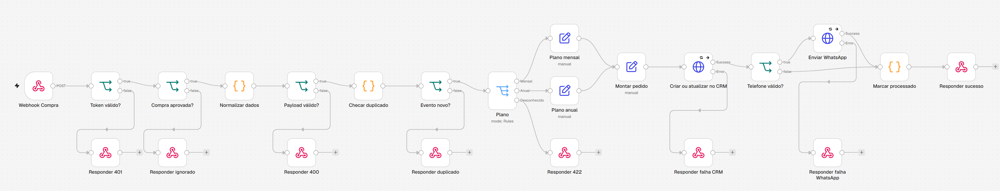

# compra-aprovada

Fluxo de demonstração com dados fictícios. A empresa, os produtos e as pessoas não existem, e nada aqui rodou em produção.

## Problema

Uma plataforma de pagamento avisa por webhook que uma compra foi aprovada. A partir daí o aluno precisa entrar no CRM e receber a mensagem de boas-vindas certa para o plano que comprou. O webhook pode chegar repetido, pode vir de quem não deveria, o telefone vem digitado de qualquer jeito e o CRM ou o WhatsApp podem estar fora do ar.

## Como funciona



1. **Webhook Compra** recebe o POST. O payload segue o estilo do formato da Hotmart (`event`, `data.product`, `data.buyer`, `data.purchase`), com valores inventados. Exemplo em [`payload-exemplo.json`](payload-exemplo.json).
2. **Token válido?** compara o header `x-webhook-token` com a variável `WEBHOOK_TOKEN`. Se a variável estiver vazia, recusa. Sem token certo responde 401 e para.
3. **Compra aprovada?** deixa passar só `PURCHASE_APPROVED`. Outros eventos recebem 200 com `ignorado`, para a plataforma não ficar reenviando.
4. **Normalizar dados** extrai os campos e converte o telefone para `55` + DDD + 9 + 8 dígitos. Aceita número sem DDI e celular antigo sem o nono dígito. O que não vira celular brasileiro fica como inválido.
5. **Payload válido?** exige transação e e-mail. Sem eles responde 400.
6. **Checar duplicado** e **Evento novo?** procuram a chave `evento:transação` no static data do fluxo. Se já foi processada, responde 200 com `duplicado` e não chama ninguém.
7. **Plano** separa o caminho pelo id do produto: mensal, anual ou desconhecido. Cada plano define tag, dias de acesso e texto da mensagem. Produto desconhecido responde 422.
8. **Criar ou atualizar no CRM** faz upsert pelo e-mail. A compra entra no CRM mesmo com telefone inválido, com a tag `telefone-invalido`, para o time conseguir tratar.
9. **Telefone válido?** decide se manda o WhatsApp.
10. **Marcar processado** grava a chave do evento e **Responder sucesso** devolve o resumo.

### Tratamento de erro

CRM e WhatsApp tentam 2 vezes, com 1 segundo entre as tentativas. Se ainda assim falharem, o fluxo responde 502 com a etapa que quebrou e não marca o evento como processado. Assim uma reentrega da plataforma é executada de novo. Se o WhatsApp falhar depois do CRM, a reentrega repete o upsert, que não duplica o contato.

## Como importar

1. No n8n, abra **Workflows**, depois **Import from File**, e escolha `workflow.json`.
2. Defina no ambiente do n8n as variáveis de `.env.example`, incluindo `N8N_BLOCK_ENV_ACCESS_IN_NODE=false`, que libera `$env` nas expressões.
3. Troque os caminhos `/contacts/upsert` e `/messages` e os corpos dos nós HTTP pelo contrato do seu CRM e do seu provedor de WhatsApp.
4. Troque os ids `900001` e `900002` em **Normalizar dados** pelos seus produtos.
5. Ative o fluxo. O endereço fica em `/webhook/compra-aprovada`.

## Como testar

Siga o [README da raiz](../README.md#como-rodar). Para mandar um evento na mão, com o n8n e o mock no ar:

```bash
curl -X POST http://127.0.0.1:5678/webhook/compra-aprovada \
  -H "content-type: application/json" \
  -H "x-webhook-token: <valor de WEBHOOK_TOKEN no .env>" \
  -d @compra-aprovada/payload-exemplo.json
```

## Limitações

- O static data do n8n é gravado no fim da execução. Duas entregas iguais ao mesmo tempo podem passar as duas pelo filtro. Em produção eu trocaria por uma chave única em Redis ou Postgres.
- A comparação do token é uma igualdade simples, sem tempo constante.
- A validação aceita só celular brasileiro.
